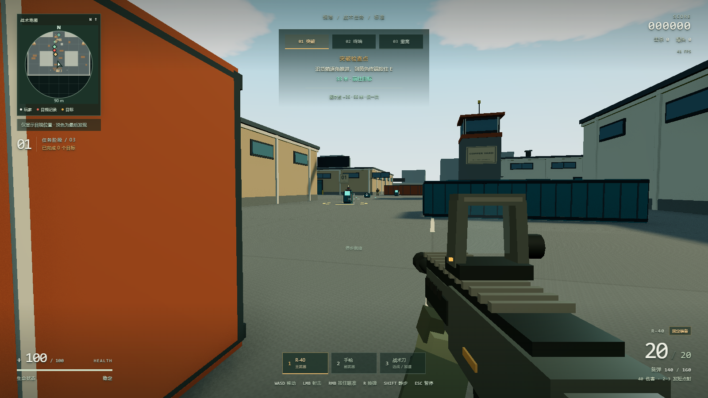

# 铜港货场 · Copper Yard

一个单人、离线可玩的网页版短局战术 FPS。围绕清角、预瞄、急停和短促交火设计：敌人会巡逻、听声、换位与侧翼进攻，失误后可以快速重试。

本仓库是铜港地图与战术模式的独立版本，包含可直接游玩的 `index.html`、完整运行源码、构建脚本和自动化测试。



## 开始游戏

**[在线试玩铜港货场](https://hsrxr.github.io/copper-yard-fps/)** — 打开链接，点击“开始行动”即可游玩。

使用支持 WebGL2 的桌面 Chrome 或 Edge，搭配键盘、鼠标。进入游戏后会捕获鼠标；按 Esc 暂停并释放鼠标。

主菜单右上角与暂停页均提供“进入全屏 / 退出全屏”按钮。全屏同时显示游戏和界面，减少浏览器边框干扰；退出全屏时会暂停正在进行的战斗。切换后画面自动适配窗口，保留当前画质和渲染分辨率设置。

离线游玩时，下载仓库后直接打开 **`index.html`** 即可。

也可以通过本地服务运行：

```sh
python -m http.server 8080 --bind 127.0.0.1
```

随后访问 <http://127.0.0.1:8080>。游戏运行不需要 npm、不依赖 CDN，也不需要账号；画面、武器、音效与依赖均包含在单个 HTML 中。

## 玩法

从南门进入货场，依次完成 **突破检查点 → 读取中街终端 → 北门撤离**。靠近目标按住 E 完成交互；松手、离开、受伤或暂停会中断。无需清空全部敌人。

- 10 名预置敌人，3 种部署变体；重试保持同一部署，“新任务”更换部署。
- 敌人具有视线、掩体、巡逻、听觉与换位逻辑。跑动和枪声会暴露位置，Shift 静步无脚步声。
- 固定步枪、手枪和战术刀；短 TTK、区分头部与身体命中，重装兵有头盔与正面胸甲。
- 战术刀背后重击直接击杀：命中瞬间位于敌人正后方左右各 60° 内，右键重刀命中任意部位即可处决，包括戴头盔的重装兵。处决独立于基础伤害，显示“背刺击杀”；仍须在 2.7 米攻击范围内实际命中，不能穿透掩体，保留 0.28 秒命中延迟与 1.05 秒冷却。正面、侧面及轻击继续按普通伤害处理。
- 地面默认奔跑，反向轻点可急停；停稳后首发更准，移动、跳跃与连续开火增加偏差。
- 任务中有一次固定医疗补给；击杀不升级、不回血，不掉随机补给。
- 提供标准、困难两档难度；最近 500 次游玩记录与设置保存在当前浏览器，累计战绩与成就持续保留，也可手动导出战绩。
- “标准模式通关”和“困难模式通关”成就分别在对应难度成功撤离后解锁；现存记录中的成功撤离会自动补发，成就不受记录保留上限影响。

### 操作

| 操作 | 按键 |
| --- | --- |
| 移动 / 转向 | WASD / 鼠标 |
| 无声静步 | Shift + WASD |
| 射击 / 刀轻击 | 鼠标左键 |
| 开镜 / 刀重击 | 鼠标右键 |
| 步枪 / 手枪 / 刀 | 1 / 2 / 3 |
| 跳跃 | 空格 |
| 换弹 | R |
| 武器检视 / 取消 | Y |
| 任务、医疗与撤离交互 | 靠近后按住 E |
| 暂停 / 释放鼠标 | Esc |
| 死亡或完成后快速重试 | R / Enter |

开镜支持“按住”或“点击切换”。主菜单与暂停页可设置灵敏度、四种准心、画质效果和渲染分辨率。腰射、开镜使用同一种准心；静止时持枪不持续晃动。

按 Y 检视当前步枪、手枪或战术刀，再按 Y 取消；长按不会循环。检视期间可移动、静步、转视角和跳跃，起跳与落地均不会打断，也可在空中或按住跳跃键时开始检视。开火、开镜、换弹、切枪、交互、受伤或暂停会立即打断，不增加开火延迟，不改变弹药、精度或人物朝向。换弹、切枪、攻击和开镜期间不能开始检视。

画质效果与渲染分辨率独立：分辨率支持 50% / 75% / 100% / 125% / 150%，自动调整只降低特效。鼠标优先使用原始输入，浏览器明确不支持时回退到普通鼠标锁定。

玩家步枪与手枪使用“C 清脆晶响”开枪音效；身体命中、头部命中、身体击杀和爆头击杀使用“A 干脆竞技”对应反馈。一发攻击只播放实际结果对应的确认声。选定音效随页面内嵌，首次开枪即可播放，离线也可使用。

### 枪械与精度

| 武器 | 伤害 / 爆头倍率 | 射速 | 弹匣 | 开镜时间 |
| --- | --- | --- | --- | --- |
| R-40 步枪 | 40 / ×3 | 480 RPM | 20 | 0.18 秒 |
| P-50 手枪 | 50 / ×2 | 240 RPM，半自动 | 8 | 0.12 秒 |

停稳且射击散布充分恢复后，在 30 米垂直目标平面上，首发每轴最大随机偏移：步枪腰射约 6.75 厘米、完整开镜约 0.98 厘米；手枪分别约 9 厘米与 1.35 厘米。首发保留小幅随机偏差；本发产生的连射散布从后续子弹起生效。

## 修改与构建

运行需要支持 WebGL2 的桌面浏览器；构建只需要 Python 3 标准库。逻辑测试需要 Node.js 20 或更高版本，浏览器验收另需安装开发依赖。

```sh
python build.py
node --test qa/*.test.cjs
```

`build.py` 将源码、选定音效、Three.js 和第三方许可证内嵌到 `index.html`。修改 `src/` 或 `assets/audio/` 后重新构建即可，不要只修改生成的 HTML。

在线版本由 GitHub Pages 从 `main` 分支根目录发布。更新游戏后，将源码和重新构建的 `index.html` 一并提交、推送到 `main`，GitHub 会自动更新试玩页；根目录的 `.nojekyll` 让页面按静态文件发布。

浏览器验收：

```sh
npm ci
npm run test:browser
npm run test:fullscreen
npm run test:audio
npm run test:inspect
npm run test:backstab
```

验收默认尝试已安装的 Chrome，必要时可用 `COPPER_BROWSER` 指定浏览器可执行文件，或用 `COPPER_BROWSER_CHANNEL` 指定 Playwright 通道。也可以先运行 `npx playwright install chromium` 安装测试浏览器。测试结果与截图写入 `qa/artifacts/`，不会作为源码提交。

浏览器验收通过独立浏览器环境检查任务、枪械、敌人攻击、暂停与重试；部分场景使用测试接口定位与控制状态，不代表人工通关或完整平衡性评测。

## 项目结构

- `src/arena.js`：货场地图、障碍物与导航。
- `src/mission.js`：任务阶段、部署与交互。
- `src/combat.js`、`src/enemies.js`、`src/player.js`：战斗、敌人行为与玩家移动。
- `src/app.js`：输入、游戏流程和渲染调度。
- `src/hud.js`、`src/viewmodel.js`、`src/shell.html`：界面、持枪表现和页面。
- `vendor/`：随仓库提供的 Three.js 与许可证。
- `assets/audio/`：选定的原创开枪与命中反馈音效。
- `qa/`：逻辑与浏览器测试。
- `build.py` / `index.html`：构建脚本 / 可直接运行的游戏。

设置与战绩使用独立的 `copper-yard-fps.*` 本地存储空间。游戏不上传战绩；源码中的 `CopperYardFPS` 接口用于本地测试与调试。

## 第三方内容

Three.js r160 使用 MIT 许可证，完整许可见 [`vendor/THREE-LICENSE.txt`](vendor/THREE-LICENSE.txt)，构建后的 HTML 同样保留该声明。
